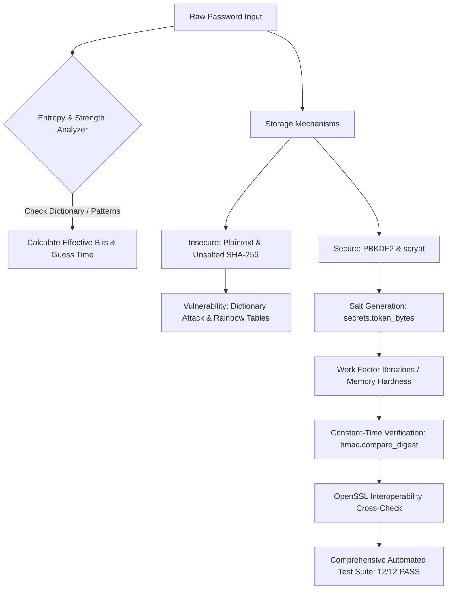
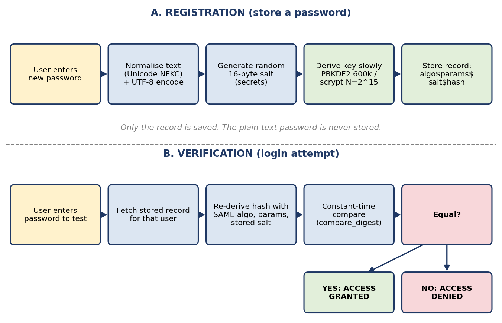
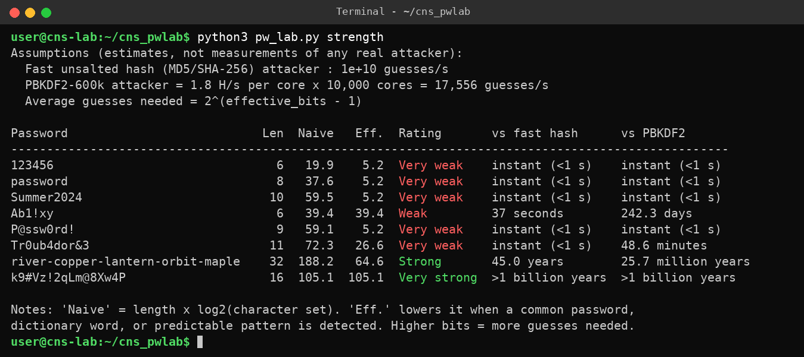
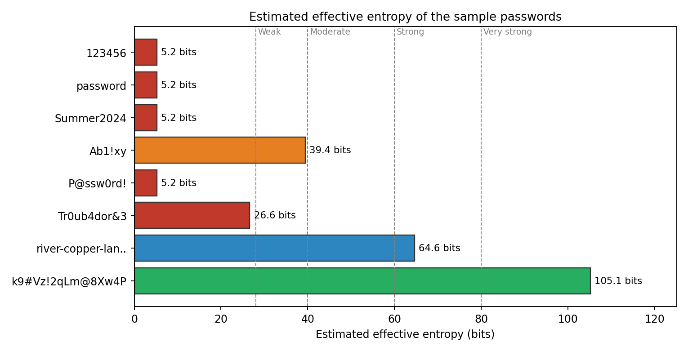
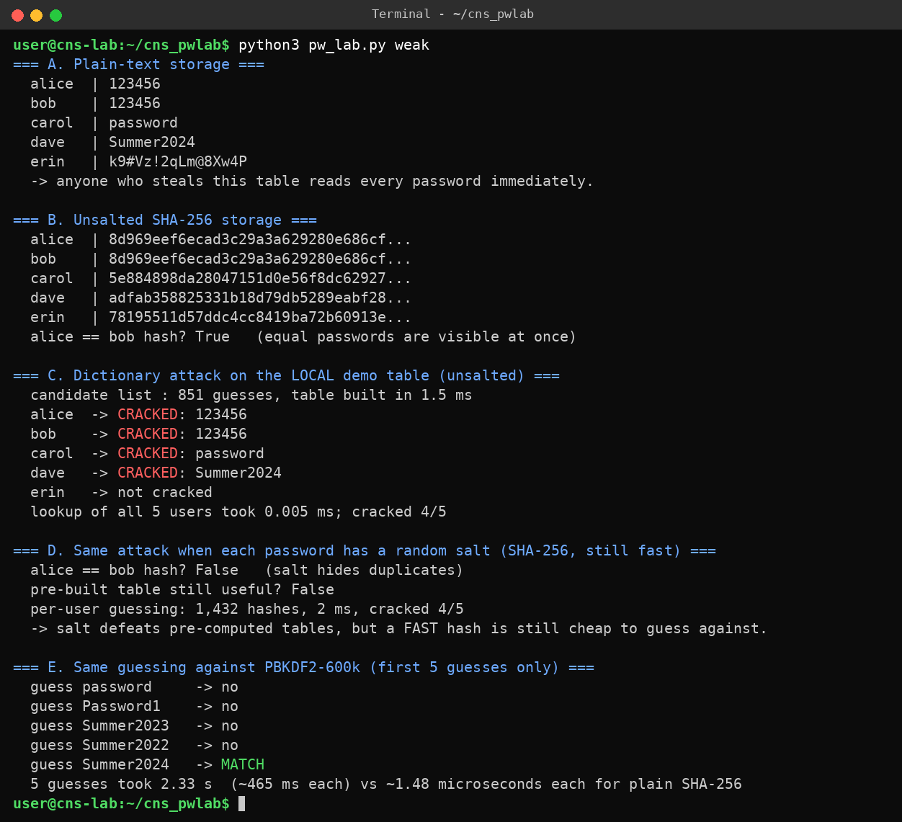
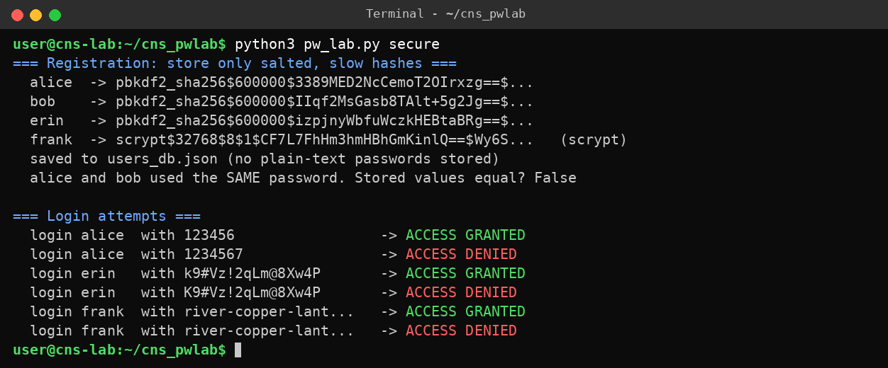
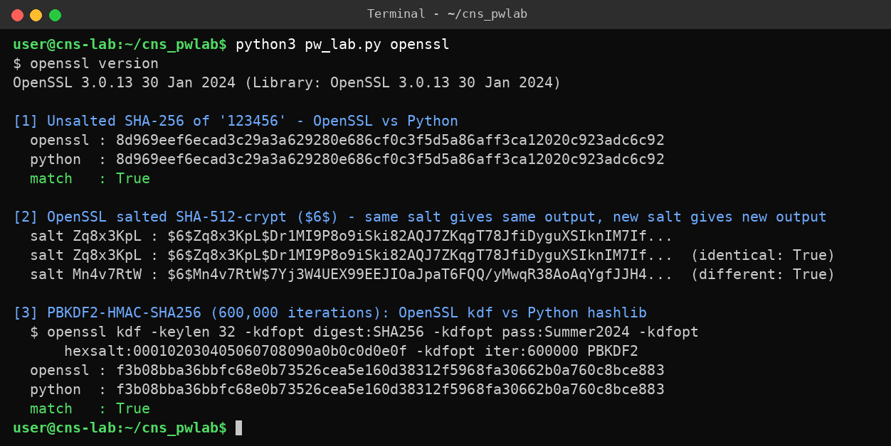
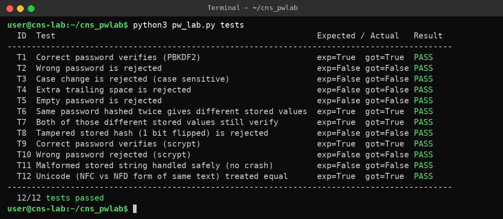
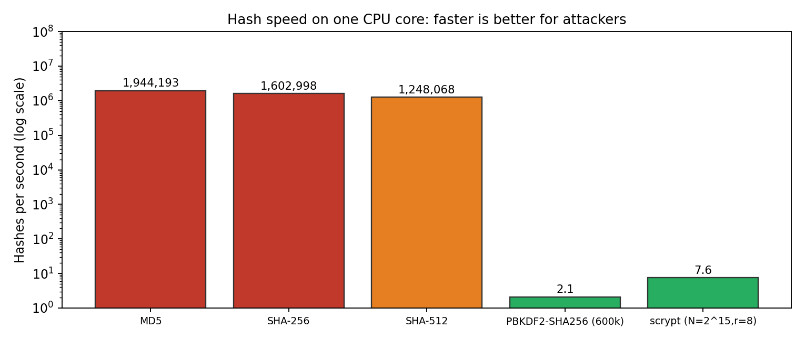

# BCS703 Experiential Learning - Theme C: Password Security

[](https://www.python.org/)
[](LICENSE)
[](https://www.openssl.org/)

An experiential learning laboratory project designed to explore password strength evaluation, demonstrate the catastrophic flaws of insecure password storage, implement robust cryptographic defenses (PBKDF2-HMAC-SHA256 & scrypt), and cross-verify hashing primitives with OpenSSL.

> **Safe-Use Notice**: All passwords and records used throughout this repository are purely synthetic dummy test values. All hashing, analysis, and simulated attacks run entirely in an isolated, local test harness. No live accounts, external networks, or production systems are targeted.

---

## 📌 Project Architecture & Workflow





---

## 🚀 Key Modules & Demonstrations

### 1. Password Entropy & Strength Analysis (`strength`)
- **Naive vs. Effective Entropy**: Demonstrates why calculating entropy strictly from character set size $\text{len} \times \log_2(|\Sigma|)$ gives a dangerous false sense of security.
- **Pattern & Mutation Penalties**: Reduces effective bits upon detecting common dictionary words (`Summer2024`, `password`), leetspeak substitutions (`P@ssw0rd!`), and keyboard sequences.
- **Passphrase Evaluation**: Analyzes Diceware-style multi-word passphrases (`river-copper-lantern-orbit-maple`) and random alphanumeric combinations (`k9#Vz!2qLm@8Xw4P`).
- **Crack Time Estimation**: Compares attack velocities of hardware-accelerated fast hashes ($10^{10}$ guesses/sec) versus key-stretched algorithms.




---

### 2. Vulnerability of Insecure Storage (`weak`)
- **Plaintext Storage**: Direct exposure of all credentials upon breach.
- **Unsalted Fast Hashes (SHA-256)**: Identical passwords produce identical hashes (`alice == bob`), enabling trivial duplicate detection.
- **Dictionary / Precomputation Attack**: Precomputed lookup table cracks unsalted hashes in under a millisecond.
- **Salted Fast Hashes**: Salt prevents global rainbow tables, but GPU-accelerated hash rates still make brute force viable.
- **Slow KDF Defense**: Demonstrates the exponential computational barrier imposed by PBKDF2 (600,000 iterations).



---

### 3. Cryptographically Secure Storage & Verification (`secure`)
- **Algorithms**:
  - **PBKDF2-HMAC-SHA256**: 600,000 iterations (NIST SP 800-63B recommendation).
  - **scrypt**: Memory-hard key derivation ($N=32768, r=8, p=1$).
- **Salt Generation**: 128-bit cryptographically secure random salt per credential via `secrets.token_bytes(16)`.
- **Timing Attack Resistance**: Constant-time verification using `hmac.compare_digest`.
- **Unicode Normalization**: NFKC normalization ensures consistency across equivalent Unicode sequences.
- **Storage Format**: Encoded modular crypt format: `algorithm$parameters$salt$hash`.



---

### 4. Cross-Verification with OpenSSL CLI (`openssl`)
Interoperability validation verifying that Python's cryptographic implementations match OpenSSL standards:
1. **Unsalted SHA-256**: Direct hash parity between Python `hashlib` and `openssl dgst -sha256`.
2. **SHA-512-Crypt ($6$)**: Unix shadow-compatible salted hashing via `openssl passwd -6`.
3. **PBKDF2 Key Derivation**: Verifies identical key output using `openssl kdf PBKDF2`.



---

### 5. Automated Test Suite (`tests`)
Includes 12 automated unit tests validating edge cases and defensive behavior:
- `T1` - Correct password verification (PBKDF2)
- `T2` - Rejection of incorrect passwords
- `T3` - Case-sensitivity enforcement
- `T4` - Trailing/leading whitespace rejection
- `T5` - Empty password rejection
- `T6` - Unique salt per hash invocation (same password $\to$ different hash)
- `T7` - Dual verification for distinct hashes of identical password
- `T8` - Tampered hash rejection (1-bit flip)
- `T9` - Correct password verification (scrypt)
- `T10` - Rejection of wrong passwords (scrypt)
- `T11` - Malformed hash string safety handling (graceful failure without crash)
- `T12` - Canonical Unicode normalization equality (NFC vs. NFD)



---

### 6. Performance Benchmarking (`bench`)
Measures hash throughput and latency across cryptographic algorithms:

| Algorithm | Latency per Hash | Throughput (H/s) | Relative Cost vs. SHA-256 |
| :--- | :---: | :---: | :---: |
| **MD5** | ~0.51 $\mu$s | ~1,944,000 H/s | 0.82x |
| **SHA-256** | ~0.62 $\mu$s | ~1,603,000 H/s | 1.00x |
| **SHA-512** | ~0.80 $\mu$s | ~1,248,000 H/s | 1.28x |
| **PBKDF2-SHA256 (600k)** | ~473.6 ms | ~2.1 H/s | **~759,000x slower** |
| **scrypt ($N=2^{15}, r=8$)** | ~132.4 ms | ~7.6 H/s | **~212,000x slower** |



---

## 📂 Project Structure

```plaintext
BCS703_Theme_C/
├── pw_lab.py          # Main executable CLI application
├── results.json       # Structured benchmark, entropy, and test output
├── users_db.json      # Sample local JSON database storing salted slow hashes
├── logs/              # Terminal execution transcripts for each module
│   ├── env.txt
│   ├── strength.txt
│   ├── weak.txt
│   ├── secure.txt
│   ├── openssl.txt
│   ├── tests.txt
│   ├── bench.txt
│   └── db.txt
├── shots/             # Visual execution evidence and metric charts
│   ├── flow.png
│   ├── chart_entropy.png
│   ├── chart_bench.png
│   └── s1_env.png - s8_db.png
├── .gitignore         # Git ignore rules
└── README.md          # Project documentation
```

---

## 🛠️ Usage & Execution

### Prerequisites
- Python 3.10 or later
- OpenSSL CLI (`openssl` in system PATH)

### Running the Lab
Run all modules sequentially:
```bash
python pw_lab.py all
```

Or execute individual sections:
```bash
# Environment & crypto capabilities check
python pw_lab.py env

# Password entropy and estimated crack times
python pw_lab.py strength

# Demonstration of dictionary attacks on weak/unsalted hashes
python pw_lab.py weak

# Secure PBKDF2/scrypt hashing and verification
python pw_lab.py secure

# OpenSSL cross-check
python pw_lab.py openssl

# Run 12-case test suite
python pw_lab.py tests

# Execution speed benchmarks
python pw_lab.py bench
```

---

## 🎓 Academic Attribution
- **Course**: VTU BCS703 Experiential Learning
- **Theme**: Theme C — Password Security & Cryptographic Storage
- **Student Profile**: [navyad-a](https://github.com/navyad-a)
